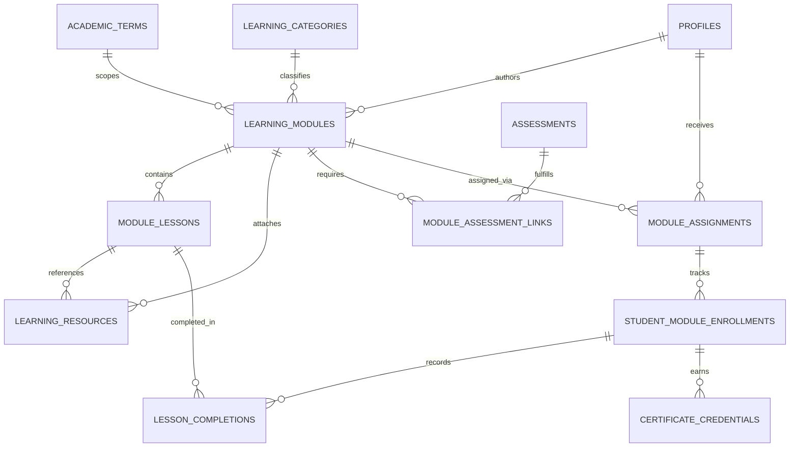
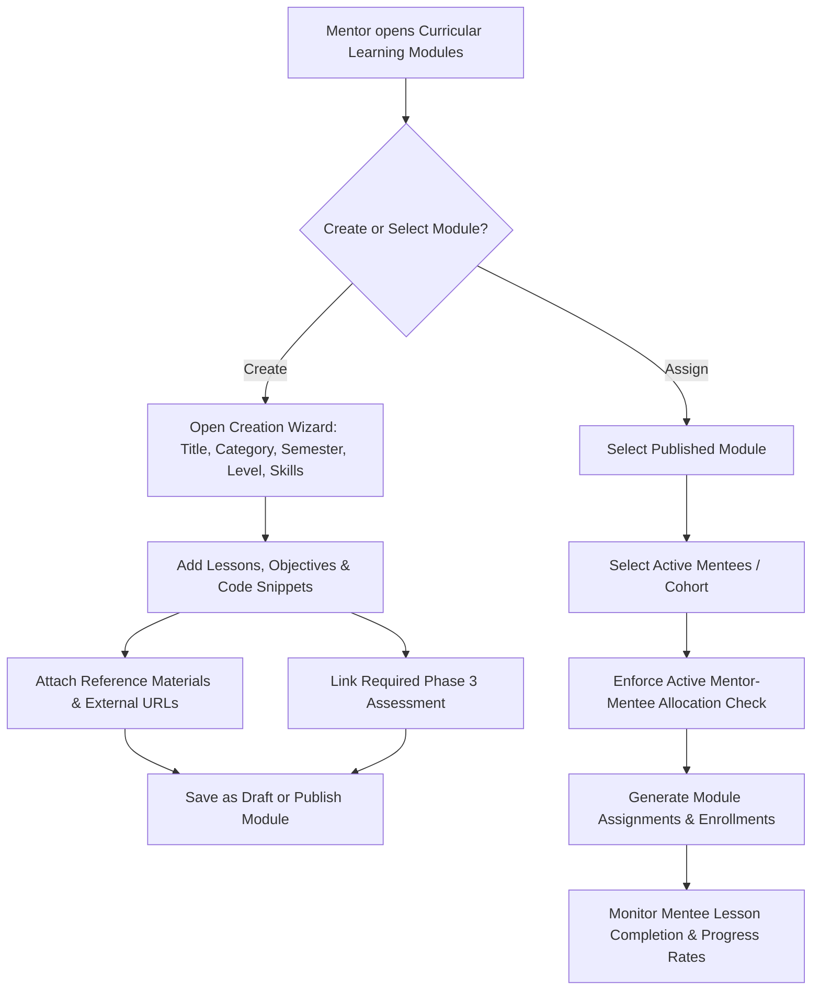
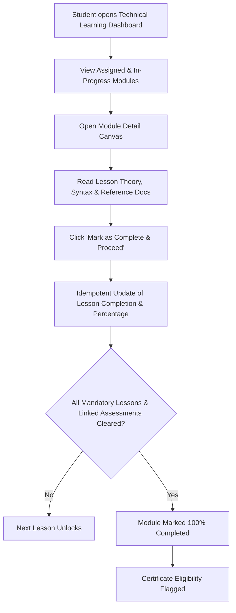
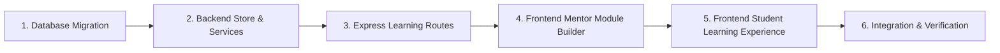

# MentorBridge — Phase 5A: Technical Learning Module Foundation
## Read-Only Architectural Audit & System Design Specification

---

### Executive Summary

An exhaustive audit of the existing **MentorBridge** codebase (Frontend, Supabase PostgreSQL schema, and Express backend) along with the connected **Stitch MCP** design workspace was performed.

Existing capabilities from previous phases are verified:
- **Phase 1 & Stitch Design System**: Academic Nexus design tokens (Plus Jakarta Sans, Inter, JetBrains Mono, deep indigo/surface color hierarchy) and dashboard shells are already wired.
- **Phase 2 Auth & Allocations**: Supabase authentication, role-based route guards, and active mentor–mentee allocation constraints (`mentor_assignments`) are active.
- **Phase 3 Assessment Engine**: Comprehensive assessment schema (`assessments`, `questions`, `options`, `attempts`, `answers`), submission review, and evaluation workflows are functional.
- **Phase 4A AI Feedback & Analytics**: Asynchronous feedback queue, OpenRouter integration, and institutional settings are operating.

Currently, **neither database tables nor backend APIs exist for learning modules, lessons, resources, or enrollments**. Both `src/features/mentor/Learning.tsx` and `src/features/student/Learning.tsx` are static mock-data shells.

Below is the comprehensive architecture, database schema, security policy, Stitch UI reuse plan, and implementation roadmap for **Phase 5A**.

---

## 1. Existing Architecture & Codebase Audit

### 1.1 Frontend Audit
| File Path | Current Status | Reusability & Observations |
| :--- | :--- | :--- |
| `src/features/mentor/Learning.tsx` | Reads from static `MOCK_LEARNING_MODULES`. Has "+ Assign New Module" and "Edit Syllabus" placeholder triggers. | Reusable card grid, progress bars, and skill tags. Needs: Module Creation Wizard modal, Lesson Editor, Resource Attachment form, and Mentee Assignment selector. |
| `src/features/student/Learning.tsx` | Reads from `MOCK_LEARNING_MODULES`. Displays module progress and lock status. | Reusable card styling, progress meters, and filter pills. Needs: Interactive Lesson Reader, Resource Drawer, Code Lab snippet container, and "Mark Complete" API trigger. |
| `src/features/student/Certificates.tsx` | Uses `MOCK_CERTIFICATES`. Includes certificate card grid and modal dialog with cryptographic hash preview. | The verification modal and credential card layout will be directly connected to the backend once certificate eligibility is issued. |
| `src/routes/index.tsx` | Routes `/mentor/learning` and `/student/learning` already exist and are properly guarded with `ProtectedRoute` and `RoleBasedRoute`. | Existing route hierarchy can be preserved without breaking changes. |
| `tailwind.config.js` | Academic Nexus tokens (`primary`, `surface`, `on-surface`, `outline`, `error`, `display`, `mono`) and base UI components (`Card`, `Badge`, `Button`, `Input`, `StatCard`). | All components and styles align with Stitch design specifications and will be reused without new dependencies. |

### 1.2 Database Audit (Existing Migrations: 8 files)
| Migration File | Tables Created | Relevance to Phase 5A |
| :--- | :--- | :--- |
| `20261030_000001_create_schema.sql` | `profiles`, `academic_terms`, `cohorts`, `student_details`, `mentor_details`, `mentor_assignments` | Foundational. `academic_terms`, `cohorts`, and `mentor_assignments` are essential for scoping modules and assignments. |
| `20261030_000002_enable_rls.sql` | RLS for Phase 2 tables, helper functions `is_admin()`, `is_active_mentor_for_student()`. | Security functions can be reused directly in learning module RLS policies. |
| `20261030_000003_seed_institutional_data.sql` | Seed profiles and academic terms. | Testing foundation. |
| `20261101_000004_create_assessment_schema.sql` | `assessments`, `assessment_questions`, `assessment_options`, `assessment_assignments`, `assessment_attempts`, `assessment_answers` | High relevance: Modules will link directly to these assessments for milestone/completion tests. |
| `20261101_000005_enable_assessment_rls.sql` | Assessment RLS. | Assessment privacy boundaries must remain intact. |
| `20261101_000006_create_ai_feedback_and_analytics_schema.sql` | `ai_feedback_reports`. | Module completions will feed into student progress reports. |
| `20261101_000007_ai_feedback_queue_hardening.sql` | AI queue lease and retry columns. | None. |
| `20261101_000008_institution_settings.sql` | `institution_settings` (singleton). | Used for institutional metadata and timezone. |

> [!NOTE]
> **Audit Finding**: Currently, **zero** tables exist for learning modules, syllabus topics, lessons, learning resources, student module progress, or certificates.

### 1.3 Backend Architecture Audit
- **Express Router**: Modular structure (`/api/admin`, `/api/assessments`, `/api/analytics`) mounted in `server/src/index.ts`. A new route mount `/api/learning` will follow this exact pattern.
- **Middleware**: `server/src/middleware/auth.ts` provides verified JWT decoding and attaches the user's role:
  - `requireAuth` (authenticated student, mentor, or admin)
  - `requireMentorOrAdmin` (mentor or admin)
  - `requireStudent` (strictly student)
  - `requireAdminAuth` (strictly admin)
- **Database Client**: `server/src/lib/supabaseAdmin.ts` provides a service-role client for validated administrative and server-side aggregation operations.
- **Mentor–Mentee Validation Convention**: Reusable helper pattern from `assessmentStore.ts` validating `mentor_assignments` where `is_active = true` before allowing mentors to assign modules or view mentee progress.

---

## 2. Proposed Database Schema and Relationships

To satisfy technical depth, syllabus mapping, semester variation, and student progress tracking, a normalized, 9-table relational schema is proposed:

### Table Specifications

#### 1. `learning_categories` (System CSE Pillars)
Stores standardized CSE syllabus disciplines:
- `id`: UUID (PK, `gen_random_uuid()`)
- `code`: TEXT UNIQUE NOT NULL (e.g., `PROG_FUND`, `DSA`, `OOP`, `DBMS`, `OS`, `NETWORKS`, `SE`, `WEB_DEV`, `AI_ML`, `SYS_DESIGN`)
- `name`: TEXT NOT NULL (e.g., "Data Structures and Algorithms")
- `description`: TEXT
- `display_order`: INTEGER NOT NULL DEFAULT 1
- `created_at`: TIMESTAMPTZ NOT NULL DEFAULT now()

#### 2. `learning_modules` (Core Syllabus Modules)
Represents a curated learning track:
- `id`: UUID (PK, `gen_random_uuid()`)
- `category_id`: UUID NOT NULL REFERENCES `learning_categories(id)` ON DELETE RESTRICT
- `academic_term_id`: UUID NOT NULL REFERENCES `academic_terms(id)` ON DELETE RESTRICT
- `created_by`: UUID NOT NULL REFERENCES `profiles(id)` ON DELETE RESTRICT
- `code`: TEXT NOT NULL (e.g., `CSE-MOD-301`)
- `title`: TEXT NOT NULL
- `description`: TEXT
- `semester`: INTEGER NOT NULL CHECK (`semester` BETWEEN 1 AND 8)
- `level`: TEXT NOT NULL CHECK (`level` IN ('Fundamental', 'Intermediate', 'Advanced'))
- `estimated_hours`: NUMERIC(4, 1) NOT NULL DEFAULT 10.0 CHECK (`estimated_hours` > 0)
- `week_number`: INTEGER CHECK (`week_number` BETWEEN 1 AND 16)
- `skills`: TEXT[] DEFAULT '{}'
- `status`: TEXT NOT NULL DEFAULT 'draft' CHECK (`status` IN ('draft', 'published', 'archived'))
- `version`: INTEGER NOT NULL DEFAULT 1 CHECK (`version` >= 1)
- `is_institutional`: BOOLEAN NOT NULL DEFAULT false
- `created_at`: TIMESTAMPTZ NOT NULL DEFAULT now()
- `updated_at`: TIMESTAMPTZ NOT NULL DEFAULT now()
- **Constraint**: `UNIQUE (code, version)`

#### 3. `module_lessons` (Topics & Pedagogical Content)
Structured individual lessons within a module:
- `id`: UUID (PK, `gen_random_uuid()`)
- `module_id`: UUID NOT NULL REFERENCES `learning_modules(id)` ON DELETE CASCADE
- `lesson_order`: INTEGER NOT NULL DEFAULT 1
- `title`: TEXT NOT NULL
- `slug`: TEXT NOT NULL
- `summary`: TEXT
- `content_markdown`: TEXT NOT NULL
- `lesson_type`: TEXT NOT NULL DEFAULT 'theory' CHECK (`lesson_type` IN ('theory', 'code_lab', 'case_study', 'milestone_prep'))
- `estimated_minutes`: INTEGER NOT NULL DEFAULT 30 CHECK (`estimated_minutes` > 0)
- `is_mandatory`: BOOLEAN NOT NULL DEFAULT true
- `code_snippet`: TEXT
- `code_language`: TEXT DEFAULT 'cpp'
- `created_at`: TIMESTAMPTZ NOT NULL DEFAULT now()
- `updated_at`: TIMESTAMPTZ NOT NULL DEFAULT now()
- **Constraint**: `UNIQUE (module_id, lesson_order)`

#### 4. `learning_resources` (Curated References & Docs)
Books, papers, documentation, or links attached to a module or lesson:
- `id`: UUID (PK, `gen_random_uuid()`)
- `module_id`: UUID NOT NULL REFERENCES `learning_modules(id)` ON DELETE CASCADE
- `lesson_id`: UUID REFERENCES `module_lessons(id)` ON DELETE CASCADE
- `title`: TEXT NOT NULL
- `resource_type`: TEXT NOT NULL CHECK (`resource_type` IN ('pdf', 'article_url', 'github_repo', 'doc', 'book_reference'))
- `url`: TEXT NOT NULL
- `description`: TEXT
- `is_mandatory`: BOOLEAN NOT NULL DEFAULT false
- `created_at`: TIMESTAMPTZ NOT NULL DEFAULT now()

#### 5. `module_assignments` (Mentor-to-Mentee Assignment Gate)
Governs assignment boundaries:
- `id`: UUID (PK, `gen_random_uuid()`)
- `module_id`: UUID NOT NULL REFERENCES `learning_modules(id)` ON DELETE CASCADE
- `mentor_id`: UUID NOT NULL REFERENCES `profiles(id)` ON DELETE RESTRICT
- `student_id`: UUID NOT NULL REFERENCES `profiles(id)` ON DELETE CASCADE
- `cohort_id`: UUID REFERENCES `cohorts(id)` ON DELETE SET NULL
- `academic_term_id`: UUID NOT NULL REFERENCES `academic_terms(id)` ON DELETE RESTRICT
- `due_date`: DATE
- `assigned_at`: TIMESTAMPTZ NOT NULL DEFAULT now()
- **Constraint**: `UNIQUE (module_id, student_id)`

#### 6. `student_module_enrollments` (Student Progress & State Container)
Tracks a student's lifecycle for a specific module:
- `id`: UUID (PK, `gen_random_uuid()`)
- `module_id`: UUID NOT NULL REFERENCES `learning_modules(id)` ON DELETE RESTRICT
- `student_id`: UUID NOT NULL REFERENCES `profiles(id)` ON DELETE CASCADE
- `assignment_id`: UUID REFERENCES `module_assignments(id)` ON DELETE SET NULL
- `status`: TEXT NOT NULL DEFAULT 'in_progress' CHECK (`status` IN ('in_progress', 'completed', 'archived'))
- `completed_lessons_count`: INTEGER NOT NULL DEFAULT 0 CHECK (`completed_lessons_count` >= 0)
- `total_lessons_count`: INTEGER NOT NULL DEFAULT 0 CHECK (`total_lessons_count` >= 0)
- `progress_percentage`: NUMERIC(5, 2) NOT NULL DEFAULT 0.0 CHECK (`progress_percentage` BETWEEN 0.0 AND 100.0)
- `enrolled_at`: TIMESTAMPTZ NOT NULL DEFAULT now()
- `last_accessed_at`: TIMESTAMPTZ DEFAULT now()
- `completed_at`: TIMESTAMPTZ
- **Constraint**: `UNIQUE (module_id, student_id)`

#### 7. `lesson_completions` (Granular Progress Ledger)
Idempotent completion tracking for each lesson:
- `id`: UUID (PK, `gen_random_uuid()`)
- `enrollment_id`: UUID NOT NULL REFERENCES `student_module_enrollments(id)` ON DELETE CASCADE
- `lesson_id`: UUID NOT NULL REFERENCES `module_lessons(id)` ON DELETE CASCADE
- `student_id`: UUID NOT NULL REFERENCES `profiles(id)` ON DELETE CASCADE
- `completed_at`: TIMESTAMPTZ NOT NULL DEFAULT now()
- `time_spent_minutes`: INTEGER DEFAULT 0 CHECK (`time_spent_minutes` >= 0)
- **Constraint**: `UNIQUE (enrollment_id, lesson_id)`

#### 8. `module_assessment_links` (Integration with Phase 3 Assessments)
Connects learning modules with existing assessments:
- `id`: UUID (PK, `gen_random_uuid()`)
- `module_id`: UUID NOT NULL REFERENCES `learning_modules(id)` ON DELETE CASCADE
- `assessment_id`: UUID NOT NULL REFERENCES `assessments(id)` ON DELETE RESTRICT
- `is_required_for_completion`: BOOLEAN NOT NULL DEFAULT true
- `min_passing_score`: NUMERIC(5, 2) NOT NULL DEFAULT 50.0 CHECK (`min_passing_score` BETWEEN 0.0 AND 100.0)
- `created_at`: TIMESTAMPTZ NOT NULL DEFAULT now()
- **Constraint**: `UNIQUE (module_id, assessment_id)`

#### 9. `certificate_credentials` (Micro-Credentials & Verification)
Stores issued certificates with nonces for cryptographic integrity:
- `id`: UUID (PK, `gen_random_uuid()`)
- `student_id`: UUID NOT NULL REFERENCES `profiles(id)` ON DELETE RESTRICT
- `module_id`: UUID NOT NULL REFERENCES `learning_modules(id)` ON DELETE RESTRICT
- `enrollment_id`: UUID NOT NULL REFERENCES `student_module_enrollments(id)` ON DELETE RESTRICT
- `certificate_no`: TEXT NOT NULL UNIQUE (e.g., `CSE-2026-DIST-84920`)
- `grade`: TEXT NOT NULL CHECK (`grade` IN ('Pass', 'Merit', 'Distinction'))
- `verifiable_hash`: TEXT NOT NULL UNIQUE (SHA-256 HMAC of student roll, module code, and timestamp)
- `accredited_by`: TEXT NOT NULL DEFAULT 'Department of Computer Science & Engineering'
- `issued_at`: TIMESTAMPTZ NOT NULL DEFAULT now()
- `status`: TEXT NOT NULL DEFAULT 'verified' CHECK (`status` IN ('verified', 'revoked'))
- **Constraint**: `UNIQUE (student_id, module_id)`

---

## 3. Role-Based Workflows

### 3.1 Mentor Workflow

### 3.2 Student Workflow

### 3.3 Institutional Admin Workflow
- Manage system-wide `learning_categories` across all 10 CSE domains.
- Map modules to semesters (Semester 1 through 8) and active academic terms (`academic_terms`).
- Mark standardized modules as `is_institutional = true` (institutional common curriculum).
- Review department-wide progress and completion metrics.

---

## 4. Proposed API Endpoints

All endpoints will be secured by JWT authentication middleware (`requireAuth`, `requireMentorOrAdmin`, `requireStudent`, or `requireAdminAuth`).

### Module Management (Mentors & Admins)
- `GET /api/learning/categories` (`requireAuth`)
  - Returns all active syllabus categories.
- `GET /api/learning/modules` (`requireAuth`)
  - Mentors: returns authored modules and institutional catalog.
  - Students: returns assigned and institutional modules for their semester.
- `POST /api/learning/modules` (`requireMentorOrAdmin`)
  - Creates a new module draft (category, semester, title, hours, skills).
- `GET /api/learning/modules/:id` (`requireAuth`)
  - Returns complete module details with lessons, resources, and linked assessments.
- `PUT /api/learning/modules/:id` (`requireMentorOrAdmin`)
  - Updates module metadata (restricted if published and students already enrolled).
- `POST /api/learning/modules/:id/publish` (`requireMentorOrAdmin`)
  - Publishes a draft module, making it available for assignment.
- `POST /api/learning/modules/:id/lessons` (`requireMentorOrAdmin`)
  - Adds/updates lessons, order, markdown content, and code snippets.
- `POST /api/learning/modules/:id/resources` (`requireMentorOrAdmin`)
  - Attaches references and documentation links.
- `POST /api/learning/modules/:id/assessments` (`requireMentorOrAdmin`)
  - Links an existing Phase 3 assessment to the module as a milestone or capstone requirement.

### Assignment & Monitoring (Mentors)
- `POST /api/learning/modules/:id/assign` (`requireMentorOrAdmin`)
  - Validates that target student IDs belong to active mentor allocations (`mentor_assignments.is_active = true`).
  - Creates entries in `module_assignments` and initializes `student_module_enrollments`.
- `GET /api/learning/modules/:id/progress` (`requireMentorOrAdmin`)
  - Returns real-time completion percentages and lesson breakdowns for assigned mentees.

### Student Learning & Progress (Students)
- `GET /api/learning/student/modules` (`requireStudent`)
  - Returns student's active enrollments, overall progress, and next active lesson.
- `GET /api/learning/student/modules/:id` (`requireStudent`)
  - Verifies student assignment/enrollment before returning module lessons and resources.
- `POST /api/learning/student/lessons/:lessonId/complete` (`requireStudent`)
  - Records lesson completion in `lesson_completions`.
  - Recalculates and updates `completed_lessons_count` and `progress_percentage`.
  - Evaluates module completion criteria.

---

## 5. Row Level Security (RLS) & Security Design

### 5.1 Authorization Boundary Principles
1. **Never Trust Frontend Roles**: Every Express route and Supabase policy validates JWT claims against `public.profiles`.
2. **Mentor–Mentee Assignment Boundary**:
   - Mentors may only assign modules to students who have an active `mentor_assignments` record with them in the current term (`is_active_mentor_for_student(student_id) = true`).
   - Mentors cannot view or modify modules or student progress outside their allocated mentees or institutional scope.
3. **Student Read & Progress Boundary**:
   - Students can only view modules that are either:
     - Directly assigned to them in `module_assignments`, OR
     - Marked `is_institutional = true` and `status = 'published'` matching their semester/cohort.
   - Students can only insert into `lesson_completions` for their own `student_id`.
   - Students have **zero write access** to `learning_modules`, `module_lessons`, `learning_resources`, `module_assessment_links`, or `certificate_credentials`.
4. **Historical Record Integrity & Safe Publishing**:
   - Once a module is `published` and has active student enrollments, structural edits (deleting lessons or renumbering) trigger incrementing the `version` number or are rejected to prevent corrupting student completion percentages.

---

## 6. Stitch Screen Reuse & UI Review

The connected Stitch project **"Mentor-Mentee Auth Platform"** (`projects/4183781779494344860`) was inspected. The design assets align with the technical learning vision:

### 6.1 Approved Screen: `CSE MentorNet – Technical Learning Dashboard`
- **Resource ID**: `projects/4183781779494344860/screens/30cd247d29194f238b1ed57180b5c869`
- **Reusability**:
  1. **Top KPI Strip**:
     - *Enrolled Modules* (Total enrolled across CSE core pillars)
     - *Modules In Progress* (Active sprints nearing due dates)
     - *Modules Completed* (Verified against ABET criteria)
     - *Overall Learning Progress* (Progress percentage with sprint velocity indicator)
  2. **Filter & Search Bar**: Search input, semester selector dropdown, core subject filter, and status pills (*All Modules*, *In Progress*, *Completed*, *Not Started*).
  3. **Module Catalog Cards**: Displays module code, subject icon, completion percentage progress bar, level tag, total lessons count, and "Continue Learning" action.
  4. **Active Module Detail View (Two-Column Layout)**:
     - **Left Column**: Curriculum Outline with lesson status indicators (*Completed* with green check, *Active* with play icon, *Locked* with lock icon).
     - **Right Canvas**: Active Lesson workspace including:
       - Header with lesson title and duration.
       - Explanatory Markdown prose.
       - C++ / Python dark-mode code snippet box with copy-to-clipboard action.
       - Reference materials list (textbooks, RFCs, IEEE papers).
       - Quick check knowledge test box.
       - Action controls: "Previous Lesson", "Ask Mentor", and "Mark as Complete & Proceed".

### 6.2 Missing Screens & States Needed (To be built cleanly in React)
1. **Mentor Module Creation & Lesson Editor**:
   - Needs a step-by-step creation wizard (reusing the pattern from screen `59ca70a84d994f6c8109c2c204103a35` *Mentor Assessment Management*).
   - Form fields: Title, CSE category selector, semester, target level, skills array, lesson markdown builder, and assessment linkage.
2. **Mentee Assignment Modal**:
   - A selector allowing mentors to pick individual mentees or entire cohorts (`CSE-A`, `CSE-B`) with deadline dates.
3. **Empty States**:
   - Already designed in Stitch (`emptyFilterState` container with `search_off` icon and "Reset All Filters" button).

---

## 7. Recommended Implementation Sequence for Phase 5A

1. **Step 5A.1 — Database Schema & RLS Migration**:
   - Write migration `20261118_000009_create_learning_module_schema.sql` defining the 9 tables, indexes, triggers, and RLS policies.
   - Seed standard `learning_categories` (10 CSE disciplines).
2. **Step 5A.2 — Backend Service Layer (`learningStore.ts`)**:
   - Implement data access methods for module creation, lesson management, resource attachment, assignment validation, and progress tracking.
3. **Step 5A.3 — Express API Routes (`learningRoutes.ts`)**:
   - Implement endpoints with role middleware and mentor-mentee boundary validation.
4. **Step 5A.4 — Mentor UI Enhancement (`src/features/mentor/Learning.tsx`)**:
   - Implement the Module Builder modal, lesson manager, and mentee assignment dialog.
   - Replace mock data with live API client integration.
5. **Step 5A.5 — Student UI Enhancement (`src/features/student/Learning.tsx`)**:
   - Implement the Stitch two-column layout: catalog view and active lesson detail reader with code snippets and completion actions.
   - Wire live progress tracking.
6. **Step 5A.6 — End-to-End Verification**:
   - Test mentor module creation -> mentee assignment -> student lesson completion -> progress recalculation.

---

## 8. Architectural Risks & Mitigations

| Risk | Impact | Mitigation Strategy |
| :--- | :--- | :--- |
| **In-Progress Lesson Mutation** | If a mentor edits or deletes lessons while students are actively learning, student progress percentages could break or exceed 100%. | Use module versioning (`version` column). Once a module has active student enrollments, structural lesson additions/deletions require cloning or saving a new version draft. |
| **Mentor Assignment Overreach** | A malicious or mistaken mentor could attempt to assign modules to students not in their allocated mentee roster. | Enforce strict server-side validation in `assignModule` against active records in `mentor_assignments`. |
| **Client-Side Progress Tampering** | A student could try to forge completion percentages via API calls. | Students never submit percentages. They only submit `POST /lessons/:id/complete`. The backend computes completion count and percentage from verified `lesson_completions` records. |
| **Circular Coupling with Phase 3 Assessments** | Linking learning modules to assessments could create dependency deadlocks. | Decoupled link table `module_assessment_links` with foreign keys to both `learning_modules(id)` and `assessments(id)`. Neither table depends on the other's existence. |

---

*Document Status: Ready for implementation approval.*

